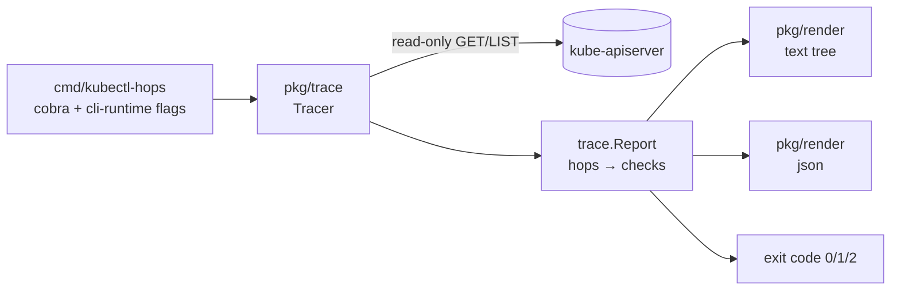

# kubectl-hops

> Trace the traffic path to a Kubernetes workload, hop by hop, and get told **where** it breaks and **why**.

`kubectl hops` follows **Ingress → Service → EndpointSlices → Pods** (plus NetworkPolicy), runs read-only checks on every hop and points at the first one that is broken, with a plain-language *likely cause* and concrete commands to try next.

> **Status: early development (milestone M1).** Tracing from `svc/<name>` works today. Ingress, Pod and NetworkPolicy checks are on the [roadmap](#roadmap).

```text
$ kubectl hops svc/web -n shop
Tracing Service shop/web

✖ Service shop/web  ← first broken hop
├─ ✔ exists: ClusterIP, ports 80→8081
├─ ✔ selector: selector app=web matches 1 pod(s)
└─ ✖ targetPort http: port 80 → targetPort 8081/TCP does not match any containerPort
      pods declare: http=8080/TCP
  ↓
✖ EndpointSlices shop/web
└─ ✖ endpoints: 0/1 endpoints ready
      not ready: web-7d9c-abc

Result: BROKEN at Service shop/web
Likely cause: Traffic is forwarded to port 8081 but the containers declare other ports; connections are likely refused. If the app really listens on 8081 without declaring it, add it to containerPorts.
Try:
  kubectl get svc web -n shop -o jsonpath='{.spec.ports}'
  kubectl get pod web-7d9c-abc -n shop -o jsonpath='{.spec.containers[*].ports}'
```

## Why

When an Ingress returns 503, the cause is usually one of a handful of misconfigurations somewhere along the path: a Service selector that matches no pods, a `targetPort` that points at the wrong port, pods that never become ready, a backend that does not exist, or a NetworkPolicy that drops the traffic. Finding it means hopping between `kubectl get ingress`, `describe svc`, `get endpointslices`, `describe pod` and `get events`, and keeping the joins in your head.

Plenty of plugins explain *one failing pod*. `kubectl hops` explains the *path*: it joins the objects the way kube-proxy and the ingress controller do and checks each link.

| Tool | What it does | Difference |
|------|--------------|------------|
| [kubectl-service-tree](https://github.com/feloy/kubectl-service-tree) | Status tree of a Service | No diagnosis, inactive since 2020 |
| [kube-lineage](https://github.com/tohjustin/kube-lineage) | Object relationships | Shows links, does not check them |
| [kubectl-reach](https://github.com/amdadulbari/kubectl-reach) | Active connectivity test from a pod | Sends traffic; `hops` only reads the API |
| why-fail, triage, k8sgpt, … | Explain a failing pod or resource | Single object, not the traffic path |

## Usage

```sh
kubectl hops svc/<name>     [-n namespace] [-o text|json]
kubectl hops ingress/<name> [-n namespace] [--host h --path p]   # M2
kubectl hops deploy/<name>  [-n namespace]                       # M2
```

All standard kubeconfig flags work (`--context`, `--kubeconfig`, `--as`, `--request-timeout`, …).

| Flag | Default | Meaning |
|------|---------|---------|
| `-o, --output` | `text` | `text` (tree) or `json` |
| `--color` | `auto` | `auto` (TTY and no `NO_COLOR`), `always`, `never` |
| `--host`, `--path` | | Select the Ingress rule to follow (ingress targets) |

### Exit codes

Designed to gate CI and smoke tests after a deploy:

| Code | Meaning |
|------|---------|
| `0` | Every hop is healthy |
| `1` | At least one hop is broken (`✖`) |
| `2` | Traffic flows, but there are warnings (`⚠`) |
| `3` | The trace could not run (bad arguments, API or RBAC error) |

## Checks

| Hop | Check | Status |
|-----|-------|--------|
| **Service** | Service exists | ✅ M1 |
| | ExternalName / headless noted | ✅ M1 |
| | Selector is non-empty and matches running pods; on a miss, a per-label breakdown with the values that *do* exist | ✅ M1 |
| | `targetPort` (number, name or default) matches a `containerPort` with the same protocol on the selected pods | ✅ M1 |
| **EndpointSlices** | Ready vs not-ready endpoints (deduplicated across dual-stack slices) | ✅ M1 |
| **Ingress** | IngressClass exists and its controller pods run; a rule matches `--host`/`--path`; backend Service and port exist | M2 |
| | `--check-tls`: TLS secret exists, certificate not expired, SAN covers host | M2 |
| **Pods** | Ready, readiness-probe failures from events, CrashLoopBackOff / OOMKilled / restarts, node NotReady | M2 |
| **NetworkPolicy** | Policies that select the target pods without an obvious rule allowing the ingress controller on that port → `⚠` | M3 |

A note on `targetPort`: `containerPort` is informational, so a numeric `targetPort` only needs the process to listen. When pods declare ports and none of them match, a typo is far more likely than an undeclared listener, so `hops` reports a failure and says so in the cause. A **named** `targetPort` that no container defines is always fatal, because the endpoint controller cannot resolve it.

## Architecture



- `pkg/trace` holds the model (`Report` → `Hop` → `Check`, each with a status, an optional likely cause and `Try:` commands) and one file per hop. Checks only depend on `kubernetes.Interface`, so every scenario is unit tested against the client-go fake clientset.
- `pkg/render` knows nothing about Kubernetes; it renders a `Report`.
- `pkg/cmd` wires flags, the client and exit codes.

The plugin needs only `get`/`list` on the objects it walks; it never writes to the cluster or sends traffic.

## Roadmap

- **M1** — CLI skeleton, Service and EndpointSlices checks, text/JSON renderer, table-driven unit tests. ✅
- **M2** — Ingress (incl. `--check-tls`) and Pod checks; `deploy/<name>` resolves the Services that select it.
- **M3** — Static NetworkPolicy check; end-to-end tests on kind using `examples/broken/*.yaml` (selector mismatch, wrong targetPort, failing readiness probe, missing backend, deny-all policy), which double as the demo; vhs GIF.
- **M4** — goreleaser multi-arch release and krew manifest.
- **Later** — Gateway API `HTTPRoute`, `--watch`, Istio `VirtualService`.

Non-goals: active probing, service-mesh data planes, eBPF.

## Development

```sh
make test    # go test -race -cover ./...
make lint    # golangci-lint v2
make build   # bin/kubectl-hops; put it on PATH to use it as `kubectl hops`
```

Requires Go 1.26+.

## License

[Apache-2.0](LICENSE)
