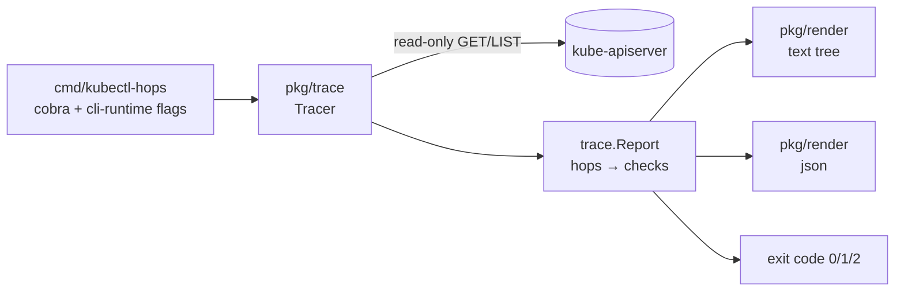

# kubectl-hops

> Trace the traffic path to a Kubernetes workload, hop by hop, and get told **where** it breaks and **why**.

`kubectl hops` follows **Ingress → Service → EndpointSlices → Pods** (plus NetworkPolicy), runs read-only checks on every hop and points at the first one that is broken, with a plain-language *likely cause* and concrete commands to try next.

> **Status: early development (milestone M2 done).** Tracing from `ingress/<name>`, `svc/<name>` and `deploy/<name>` works today, down to a diagnosis of each pod. NetworkPolicy checks and end-to-end tests are next on the [roadmap](#roadmap).

```text
$ kubectl hops ingress/shop -n shop --host shop.example.com --path /api/orders --check-tls
Tracing Ingress shop/shop

✖ Ingress shop/shop  ← first broken hop
├─ ✔ exists: 1 rule(s), 1 TLS section(s)
├─ ✔ ingressClass: IngressClass nginx (controller k8s.io/ingress-nginx)
├─ ✔ controller: 1/1 ingress-nginx pods ready in ingress-nginx
├─ ✔ address: 203.0.113.10
├─ ✔ rule: shop.example.com/api/orders matches path /api (Prefix) → svc/web:8080
├─ ⚠ tls: certificate for shop.example.com expires in 5 day(s)
└─ ✖ backend: Service web has no port 8080
      service ports: http=80
  ↓
✔ Service shop/web
├─ ✔ exists: ClusterIP, ports 80→http
├─ ✔ selector: selector app=web matches 1 pod(s)
└─ ✔ targetPort http: port 80 → targetPort http/TCP found on 1/1 pod(s)
  ↓
✔ EndpointSlices shop/web
└─ ✔ endpoints: 1/1 endpoints ready

Result: BROKEN at Ingress shop/shop
Likely cause: The Ingress backend names a port the Service does not expose (Ingress backends use the Service port, not the targetPort), so the controller has no upstream and answers 503.
Try:
  kubectl get svc web -n shop -o jsonpath='{.spec.ports}'
  kubectl get ingress shop -n shop -o yaml
```

Starting from a Deployment finds the Services that select it and the Ingresses in front of them, and explains each unhealthy pod. One crashing replica out of two degrades the path rather than breaking it:

```text
$ kubectl hops deploy/api -n shop
Tracing Deployment shop/api

⚠ Deployment shop/api
├─ ✔ exists: generation 1
├─ ⚠ replicas: 1/2 replicas ready
├─ ℹ ingresses: exposed via ingress/shop (shop.example.com/api)
└─ ✔ services: selected by svc/api
  ↓
✔ Service shop/api
├─ ✔ exists: ClusterIP, ports 80→http
├─ ✔ selector: selector app=api matches 2 pod(s)
└─ ✔ targetPort http: port 80 → targetPort http/TCP found on 2/2 pod(s)
  ↓
⚠ EndpointSlices shop/api
└─ ⚠ endpoints: 1/2 endpoints ready
      not ready: api-7c9f-q8m
  ↓
⚠ Pods shop/api
├─ ⚠ ready: 1/2 pod(s) ready
└─ ⚠ pod api-7c9f-q8m: container app: CrashLoopBackOff, 6 restart(s)
      last exit: OOMKilled, code 137

Result: DEGRADED (traffic flows, but check the warnings)
Likely cause: The container is killed for exceeding its memory limit. Raise resources.limits.memory or find what uses the memory.
Try:
  kubectl logs api-7c9f-q8m -n shop -c app --previous
  kubectl describe pod api-7c9f-q8m -n shop
```

Starting from a Service skips the Ingress hop:

```text
$ kubectl hops svc/web -n shop
Tracing Service shop/web

✖ Service shop/web  ← first broken hop
├─ ✔ exists: ClusterIP, ports 80→8081
├─ ✔ selector: selector app=web matches 1 pod(s)
└─ ✖ targetPort http: port 80 → targetPort 8081/TCP does not match any containerPort
      pods declare: http=8080/TCP
  ↓
✖ EndpointSlices shop/web
└─ ✖ endpoints: 0/1 endpoints ready
      not ready: web-7d9c-abc

Result: BROKEN at Service shop/web
Likely cause: Traffic is forwarded to port 8081 but the containers declare other ports; connections are likely refused. If the app really listens on 8081 without declaring it, add it to containerPorts.
Try:
  kubectl get svc web -n shop -o jsonpath='{.spec.ports}'
  kubectl get pod web-7d9c-abc -n shop -o jsonpath='{.spec.containers[*].ports}'
```

## Why

When an Ingress returns 503, the cause is usually one of a handful of misconfigurations somewhere along the path: a Service selector that matches no pods, a `targetPort` that points at the wrong port, pods that never become ready, a backend that does not exist, or a NetworkPolicy that drops the traffic. Finding it means hopping between `kubectl get ingress`, `describe svc`, `get endpointslices`, `describe pod` and `get events`, and keeping the joins in your head.

Plenty of plugins explain *one failing pod*. `kubectl hops` explains the *path*: it joins the objects the way kube-proxy and the ingress controller do and checks each link.

| Tool | What it does | Difference |
|------|--------------|------------|
| [kubectl-service-tree](https://github.com/feloy/kubectl-service-tree) | Status tree of a Service | No diagnosis, inactive since 2020 |
| [kube-lineage](https://github.com/tohjustin/kube-lineage) | Object relationships | Shows links, does not check them |
| [kubectl-reach](https://github.com/amdadulbari/kubectl-reach) | Active connectivity test from a pod | Sends traffic; `hops` only reads the API |
| why-fail, triage, k8sgpt, … | Explain a failing pod or resource | Single object, not the traffic path |

## Usage

```sh
kubectl hops ingress/<name> [-n namespace] [--host h] [--path p] [--check-tls] [-o text|json]
kubectl hops svc/<name>     [-n namespace] [-o text|json]
kubectl hops deploy/<name>  [-n namespace] [-o text|json]
```

All standard kubeconfig flags work (`--context`, `--kubeconfig`, `--as`, `--request-timeout`, …).

| Flag | Default | Meaning |
|------|---------|---------|
| `-o, --output` | `text` | `text` (tree) or `json` |
| `--color` | `auto` | `auto` (TTY and no `NO_COLOR`), `always`, `never` |
| `--host` | first rule host | Ingress host to follow; exact hosts beat `*.wildcard` hosts, which beat catch-all rules. A pasted URL works too: `https://shop.example.com/api` sets host and path |
| `--path` | `/` | Request path; the longest matching path wins, `Exact` beats `Prefix` |
| `--check-tls` | off | Read the Ingress TLS secret and check expiry and SANs (only `tls.crt` is parsed) |
| `--version` | | Print the version (`-v` is left alone; kubectl uses it for log verbosity) |

### Exit codes

Designed to gate CI and smoke tests after a deploy:

| Code | Meaning |
|------|---------|
| `0` | Every hop is healthy |
| `1` | At least one hop is broken (`✖`) |
| `2` | Traffic flows, but there are warnings (`⚠`) |
| `3` | The trace could not run (bad arguments, API or RBAC error) |

## Checks

| Hop | Check | Status |
|-----|-------|--------|
| **Ingress** | Ingress exists | ✅ M2 |
| | IngressClass resolves (`spec.ingressClassName`, the deprecated annotation, or the single default class) | ✅ M2 |
| | Controller pods run and are ready (ingress-nginx, NGINX Inc., Kong, Traefik, HAProxy, AWS LBC; managed GKE/Azure noted). No pods with the standard labels is a `⚠`, since custom installs relabel | ✅ M2 |
| | The controller has published an address in `status` | ✅ M2 |
| | A rule matches `--host`/`--path` the way controllers pick it, else `defaultBackend`, else ✖ with the rules that exist | ✅ M2 |
| | Backend Service exists and exposes the backend port (by name or number) | ✅ M2 |
| | `--check-tls`: a TLS section covers the host, its secret exists, the certificate is in date (⚠ under 14 days) and its SANs cover the host | ✅ M2 |
| **Service** | Service exists | ✅ M1 |
| | ExternalName / headless noted | ✅ M1 |
| | Selector is non-empty and matches running pods; on a miss, a per-label breakdown with the values that *do* exist | ✅ M1 |
| | `targetPort` (number, name or default) matches a `containerPort` or a readiness/liveness/startup probe port, with the same protocol | ✅ M2 |
| **EndpointSlices** | Ready vs not-ready endpoints (deduplicated across dual-stack slices) | ✅ M1 |
| **Pods** | Why each pod is not ready, in the order you would check: Unschedulable, image pull errors, missing ConfigMap/Secret, CrashLoopBackOff (with OOMKilled or exit code), node NotReady, readiness-probe failures from events | ✅ M2 |
| | Ready pods that restarted in the last 24h (OOMKilled called out, liveness failures attached) → `⚠` | ✅ M2 |
| | A broken pod is `✖` only when no pod is ready; otherwise traffic still flows and it is `⚠`. At most 5 pods are listed, failures first | ✅ M2 |
| **Deployment** | Ready vs desired replicas, scaled to zero, rollout stuck (`ProgressDeadlineExceeded`) or in progress | ✅ M2 |
| | Services whose selector matches the pod template (each one traced), Ingresses routing to them | ✅ M2 |
| **NetworkPolicy** | Policies that select the target pods without an obvious rule allowing the ingress controller on that port → `⚠` | M3 |

A note on `targetPort`: `containerPort` is informational, so a numeric `targetPort` only needs the process to listen. A probe aimed at that port proves something listens there, so it counts as a match. When pods declare ports and neither they nor a probe match, a typo is far more likely than an undeclared listener, so `hops` reports a failure and says so in the cause. When pods declare nothing and their probes use another port, it is a warning. A **named** `targetPort` that no container defines is always fatal, because the endpoint controller cannot resolve it.

## Architecture



- `pkg/trace` holds the model (`Report` → `Hop` → `Check`, each with a status, an optional likely cause and `Try:` commands) and one file per hop. Checks only depend on `kubernetes.Interface`, so every scenario is unit tested against the client-go fake clientset.
- `pkg/render` knows nothing about Kubernetes; it renders a `Report`.
- `pkg/cmd` wires flags, the client and exit codes.

The plugin needs only `get`/`list` on the objects it walks (Deployments, Ingresses, IngressClasses, Services, EndpointSlices, Pods, Events, Nodes; Secrets only with `--check-tls`); it never writes to the cluster or sends traffic. Missing permissions for optional checks, such as listing controller pods cluster-wide, turn those checks into notes instead of errors.

## Roadmap

- **M1** — CLI skeleton, Service and EndpointSlices checks, text/JSON renderer, table-driven unit tests. ✅
- **M2** — Ingress hop incl. `--check-tls`, probe-aware `targetPort` check, Pods hop, `deploy/<name>`. ✅
- **M3** — Static NetworkPolicy check; end-to-end tests on kind using `examples/broken/*.yaml` (selector mismatch, wrong targetPort, failing readiness probe, missing backend, deny-all policy), which double as the demo; vhs GIF.
- **M4** — goreleaser multi-arch release and krew manifest.
- **Later** — Gateway API `HTTPRoute`, `--watch`, Istio `VirtualService`.

Non-goals: active probing, service-mesh data planes, eBPF.

## Development

```sh
make test    # go test -race -cover ./...
make lint    # golangci-lint v2
make build   # bin/kubectl-hops; put it on PATH to use it as `kubectl hops`
```

Requires Go 1.26+.

## License

[Apache-2.0](LICENSE)
